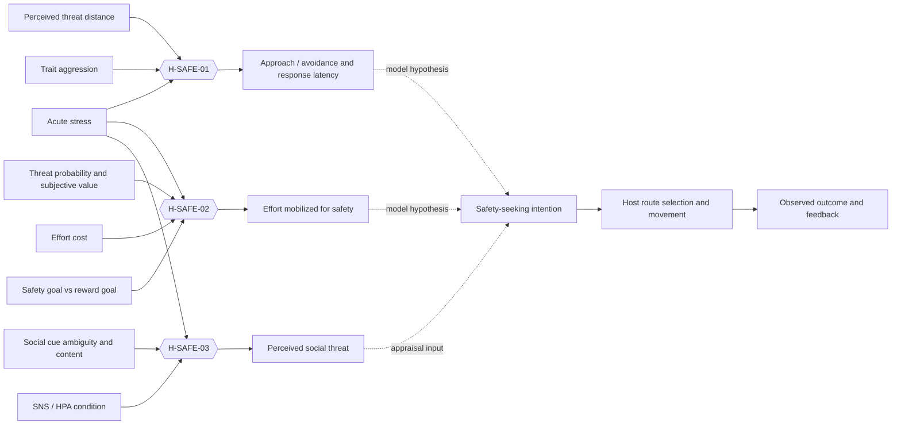

# Evidence-linked behavioral hypergraph

**Status:** research-to-model specification; not an approved parameter set. This document defines how evidence should connect internal state, perceived context, decisions, and host-executed behavior. It does not claim that the current Artificial Culture implementation already models these chains.

## Purpose

Artificial Culture should produce a coherent sequence from a changing internal state to an intention that can be observed in the world:

`internal state + perceived situation + personal/social context → appraisal and goal competition → action intention + target/route preference → host execution → observed outcome → updated state and memory`

The unit of research mapping is a **hyperedge**: one empirically studied combination of conditions and moderators linked to one or more measured outcomes. A useful inventory is complete when all candidate variables, outcomes, moderators, evidence, and gaps in the chosen scope are represented. It is not a claim that every variable causally connects to every other variable. Unsupported all-to-all edges would make the graph look complete while hiding where the evidence ends.

Fuzzy values can represent graded membership in model concepts such as “high stress” or “near threat.” They are not probabilities, effect sizes, or empirically calibrated merely because they lie in [0,1]. A paper may justify the direction or context of a relation without supplying fuzzy membership curves, thresholds, or game-ready weights. Such values must remain explicitly provisional until calibrated and tested.



Solid evidence edges end at the measured outcomes. Dashed edges are proposed game-model links and still need standalone counterfactual testing and later human-perception testing.

## First evidence-backed chain: acute stress, threat, and safety seeking

| Hyperedge | Inputs that must remain linked | Empirical outcome | Modeling implication | Evidence boundary |
|---|---|---|---|---|
| H-SAFE-01 | Acute stress induction × threat distance × trait aggression | In an approach-avoidance conflict task, stress increased behavioral inhibition when threat was distant and accelerated responses when threat was close; high-trait-aggression participants showed more approach, especially under stress. | Do not map stress to a fixed “flee” action. Let stress interact with perceived threat proximity and individual differences when evaluating approach, avoidance, and response timing. | One lab task and sample; response timing/approach behavior does not specify an NPC route planner or a universal human rule. Trait aggression is not interchangeable with neuroticism. [Vogel & Schwabe, 2019](https://pubmed.ncbi.nlm.nih.gov/30685681/). |
| H-SAFE-02 | Acute stress × threat probability/subjective value × effort cost × safety goal versus monetary reward goal | Two experiments found stress increased effort for safety-related threat avoidance, but not effort for monetary rewards; effort depended on subjective safety value and effort-threat tradeoff. | Safety seeking should compete with other goals and route/action costs. The same stress state need not increase every motivated action. | The task used threat-of-shock and grip-force effort; it supports a selective effort tradeoff, not a travel-distance coefficient for this game. [Acute stress promotes effort mobilization for safety-related goals](https://pmc.ncbi.nlm.nih.gov/articles/PMC11332123/). |
| H-SAFE-03 | Stress induction × social cue ambiguity/content × biological stress-system condition | A randomized study found post-stress social threat ratings depended on the cue and on manipulation of SNS/HPA systems; neutral faces could be judged as more threatening under placebo after stress. | In social scenes, perceived threat is an appraisal input with uncertainty and cue type; it should not be silently equated with physical danger. | Face-rating judgments do not establish movement, aggression, or behavior toward real people. [The effects of suppressing the biological stress systems on social threat-assessment following acute stress](https://pmc.ncbi.nlm.nih.gov/articles/PMC7525279/). |

### Candidate execution chain (hypothesis, not a finding of those papers)

1. **Host perception:** GotH supplies visible agents, hazards, safe locations, distances, route costs, and whether a route is accessible. The host remains authoritative for world facts and movement.
2. **Appraisal:** Artificial Culture maintains an acute stress state and an agent-specific threat appraisal from perceived evidence. Social ambiguity and physical hazard stay distinct inputs.
3. **Goal competition:** safety seeking competes with hunger, thirst, rest, social goals, and effort/time cost. Stress may change selected tradeoffs only where a cited edge supports that moderation.
4. **Intention:** the module emits a goal such as `find_safety`, with a target or preferred destination and urgency/choice metadata. It does not move the entity or claim that a route succeeded.
5. **Observed behavior:** GotH chooses/executes a route and reports the outcome. Tests record whether intention, route choice, latency, interruption, and destination changed under matched counterfactuals.
6. **Feedback:** only host-confirmed outcomes update need satisfaction, learning, or memory. A failed or blocked route must not be remembered as successful safety.

The concrete mapping from a cognitive intention to route preference, movement speed, or motor pattern is currently a **model hypothesis**. These sources motivate a scenario matrix; they do not validate that mapping.

## Standalone counterfactual matrix

Use matched scenarios with the same seed, agent, map, resource state, and available destinations. Change one experimental factor at a time, then run planned interactions. Do not assign arbitrary numeric stress levels and call them human thresholds. Initially label conditions qualitatively (`lower/higher acute stress`, `near/far threat`, `lower/higher route effort`) and record the exact experimental encoding.

| Factor | Levels to contrast | What to record |
|---|---|---|
| Acute stress | lower / higher | internal state before and after; selected goal; intention latency |
| Physical threat distance | far / near | perceived distance; approach/avoid choice; interruptions; time to safety |
| Safety route cost | lower / higher effort | chosen safe destination and alternative; rejected options; route effort reported by host |
| Competing reward | safety goal / non-safety reward available | which goal wins and under what combination |
| Social cue | clear threat / ambiguous neutral cue | social threat appraisal and whether the outcome differs from physical-danger cases |
| Individual variation | low / high measured aggression analogue, only when explicitly modeled | whether the stress × proximity relation changes; do not relabel another trait as aggression |

**Required counterfactuals:** (a) stress change with all context fixed; (b) distance change at each stress condition; (c) route-cost change while threat is fixed; (d) remove the threat while keeping stress high; (e) offer a competing need/reward. Report distributions and exceptions over multiple seeds. A design invariant is that Artificial Culture proposes intentions while the host confirms physical execution and results.

## Hyperedge record format

Every new edge should record:

```yaml
id: H-...
inputs: [measured or modeled variable, context variable, moderator]
outcome: observable study measure
direction: reported contrast; do not invent a coefficient
study: full citation and DOI/URL
design: sample, manipulation/comparison, task, outcome
population_and_scope: what the result applies to
limitations: what it does not establish
model_mapping: proposed internal state, intention, or test
parameter_status: none | exploratory | calibrated
falsifying_counterfactuals: matched contrasts that could reject the mapping
```

Keep **evidence edges** (what a study measured), **model edges** (our proposed causal chain), and **perception-test edges** (what observers judge) visually and textually distinct. A perception study can establish that behavior appears human-like in its test conditions; it cannot validate the proposed biological mechanism by itself.

## Current implementation gap

The current `NeedState` has hunger, thirst, rest, safety, and social satisfaction, but no stress variable. `PerceptionSnapshot` has resource and agent observations, but no threat observation or route-effort estimate. The current safety action is selected from safety need and a visible safe-zone resource. It does not implement H-SAFE-01/02, a stress × threat hyperedge, or a movement/route intention. The standalone community harness currently exercises testimony and social contacts, not this chain.

Therefore, the next executable slice should introduce only the smallest host contract needed for this chain: perceived threat/route options in, a safety-seeking intention with destination preference out, and host-confirmed execution feedback. Its initial parameters must be marked exploratory, paired with the counterfactuals above, and must not be described as empirically calibrated. The old fuzzy flow draft is not an implementation specification.

## Source checks

- Vogel, S. & Schwabe, L. (2019). “Stress, aggression, and the balance of approach and avoidance.” *Psychoneuroendocrinology*, DOI: [10.1016/j.psyneuen.2019.01.020](https://doi.org/10.1016/j.psyneuen.2019.01.020).
- “Acute stress promotes effort mobilization for safety-related goals.” Primary full text: [PubMed Central](https://pmc.ncbi.nlm.nih.gov/articles/PMC11332123/).
- “The effects of suppressing the biological stress systems on social threat-assessment following acute stress.” DOI: [10.1007/s00213-020-05591-z](https://doi.org/10.1007/s00213-020-05591-z); [PubMed Central](https://pmc.ncbi.nlm.nih.gov/articles/PMC7525279/).

